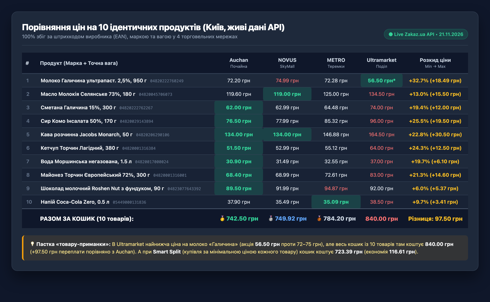

# 🛒 Sayvy — AI-помічник для вигідних покупок продуктів

**AI Product Engineering School 2026 · Hackathon Team 3**

**Sayvy** — це голосовий і текстовий AI-оптимізатор продуктового кошика по супермаркетах України (**Сільпо, NOVUS, METRO, Auchan, Ultramarket, ЕКО Маркет**). За 10–15 секунд він перетворює запит людини (*«все на сирники і кава, бюджет до 400 грн, далеко йти не хочу»*) на 3 оптимальні варіанти кошика в найближчих магазинах — із розкриттям шрінкфляції (`870 г` vs `950 г`), підбором аналогів (Private Labels) і маршрутом на карті.

👉 **Корисні посилання:**
[Концепція продукту](./PRODUCT_CONCEPT.md) · [Backend API](./backend/README.md) · [Frontend App](./frontend/README.md) · [MarTech Pipeline](./martech/README.md) · [90 готових креативів (Google Drive)](https://drive.google.com/drive/folders/1tlN3K2Z2RxFZ3zpuHarb2sdPPgqQMAdf)

---

## 🎯 Який біль вирішуємо

- **40% бюджету домогосподарств** в Україні йде на продукти (Deloitte Ukraine), і **>80% покупок** відбуваються офлайн у магазинах поруч (Gradus Research).
- **15–32% розкид цін** між мережами на ідентичний кошик (перевірено нами за штрихкодом `EAN-13`).
- **Шрінкфляція та товари-приманки:** пачка молока `870 г` за 55.99 грн виглядає дешевшою за `950 г` за 56.50 грн, але за 1 кг покупець переплачує **+8.2%**. А знижка на один товар часто маскує ~100 грн переплати на решті чеку.

### 📊 Живий замір цін на 10 ідентичних продуктів (Київ, 21.11.2026)



| № | Продукт (Марка + Точна вага) | Штрихкод (`EAN-13`) | Auchan | NOVUS | METRO | Ultramarket | Розкид ціни |
| :- | :--- | :--- | :---: | :---: | :---: | :---: | :---: |
| 1 | Молоко Галичина ультрапаст. 2,5%, 950 г | `04820222760249` | 72.20 грн | 74.99 грн | 72.28 грн | **56.50 грн\*** | **+32.7%** |
| 2 | Масло Молокія Селянське 73%, 180 г | `04820045706073` | 119.60 грн | **119.00 грн** | 125.00 грн | 134.50 грн | **+13.0%** |
| 3 | Сметана Галичина 15%, 300 г | `04820222762267` | **62.00 грн** | 62.99 грн | 64.48 грн | 74.00 грн | **+19.4%** |
| 4 | Сир Комо Інсалата 50%, 170 г | `04820029143894` | **76.50 грн** | 77.99 грн | 85.32 грн | 96.00 грн | **+25.5%** |
| 5 | Кава розчинна Jacobs Monarch, 50 г | `04820206290106` | **134.00 грн** | **134.00 грн** | 146.88 грн | 164.50 грн | **+22.8%** |
| 6 | Кетчуп Торчин Лагідний, 380 г | `04820001316384` | **51.50 грн** | 52.99 грн | 55.12 грн | 64.00 грн | **+24.3%** |
| 7 | Вода Моршинська негазована, 1.5 л | `04820017000024` | **30.90 грн** | 31.49 грн | 32.55 грн | 37.00 грн | **+19.7%** |
| 8 | Майонез Торчин Європейський 72%, 300 г | `04820001316001` | **68.40 грн** | 68.99 грн | 72.61 грн | 83.00 грн | **+21.3%** |
| 9 | Шоколад молочний Roshen Nut з фундуком, 90 г | `04823077643392` | **89.50 грн** | 91.99 грн | 94.87 грн | 92.00 грн | **+6.0%** |
| 10 | Напій Coca-Cola Zero, 0.5 л | `05449000131836` | 37.90 грн | 35.49 грн | **35.09 грн** | 38.50 грн | **+9.7%** |
| | **РАЗОМ ЗА КОШИК (10 товарів):** | | 🥇 **742.50 грн** | 🥈 **749.92 грн** | 🥉 **784.20 грн** | ❌ **840.00 грн** | **Різниця: 97.50 грн** |

> *При Smart Split між двома магазинами економія сягає **116.61 грн** на цьому ж кошику.*

---

## ⚙️ Архітектура та технологічний стек

Система розділена на **офлайн-контур (нічний ETL)** та **онлайн-контур (запит < 2 сек)**:

1. **Nightly Batch ETL (03:00 за Києвом):**
   - Оновлює каталоги, наявність, вагу та ціну за 1 кг/100 г з API **Zakaz.ua** та **Сільпо** (`443` магазини, див. [docs/stores.md](./docs/stores.md)) у **PostgreSQL 16 (Supabase)**.
   - Усуває затримку живого парсингу і зменшує витрати на LLM у десятки разів.
2. **Backend & AI Core ([backend/](./backend/)):**
   - **FastAPI** (Python 3.12+, SQLAlchemy 2 async, `uv`, `pytest`, `ruff`).
   - Модулі: `voice/` (транскрибація **Groq Whisper** + evals), `agent/` (**Qwen 27B** / LLM Intent-to-Ingredients, семантичний матчинг, формування 3 кошиків: *Найближчий*, *Найвигідніший*, *Smart Split*), `catalog/` (пошук і нормалізація цін), `geo/` (пошук магазинів і маршрути Valhalla).
3. **Frontend ([frontend/](./frontend/)):**
   - **React 19 + TypeScript + Vite 8 + TanStack Query + MapLibre GL**.
   - Дизайн-система **Sayvy** (`#111114` графіт + `#C6F432` лайм, шрифти `Onest` та `Inter`), рівноправне голосове й текстове введення.
4. **MarTech Pipeline ([martech/](./martech/)):**
   - Автоматизована генерація 30 сцен на **RunPod Community Cloud** (`RealVisXL_V5.0`, < \$0.02 за весь батч) + локальний рендер **90 банерів** у форматах `1080×1080`, `1080×1920`, `1200×628` під 6 продуктових гіпотез.

---

## 📁 Структура репозиторію

```text
hackathon-project_team3/
├── backend/                 # FastAPI-сервіс (agent, catalog, geo, voice) + міграції й тести
├── frontend/                # React + Vite SPA, дизайн-токени, карта та живий UI
├── martech/                 # RunPod генератор сцен + рендер 90 банерів під 6 гіпотез
├── docs/                    # База магазинів (443 точки), схема БД, голос/гео специфікації
├── mocks/                   # Контрактні JSON-приклади API для фронту й агента
├── tools/                   # Допоміжний стенд тестування voice & geo
├── PRODUCT_CONCEPT.md       # Детальна продуктова концепція та дослідження
└── CLAUDE.md                # API-контракти та правила розробки команди
```

---

## 🚀 Швидкий старт

### Backend (`backend/`)
```bash
cd backend
uv sync
cp .env.example .env             # вкажіть DATABASE_URL та API-ключі
uv run python -m app.migrate     # застосувати міграції БД
uv run uvicorn app.main:app --reload   # http://localhost:8000/docs
```

### Frontend (`frontend/`)
```bash
cd frontend
npm install
npm run dev                      # http://localhost:5173 (проксі на /api -> :8000)
```

### MarTech Creative Generator (`martech/`)
```bash
python3 martech/runpod_generate.py     # генерація базових сцен на RunPod
python3 martech/render_creatives.py    # рендер 3 форматів + output/manifest.csv
```

---

## 💰 Монетизація та Юніт-економіка (Web2App)

- **Модель:** **\$3.99 / міс (~165 грн)** через веб-еквайринг **Solidgate** (3.5%, без 30% комісії App Store / Google Play) після **4-денного безлімітного Opt-in тріалу** з прив'язкою картки.
- **AI COGS (Groq Whisper + Qwen 27B):** **\$0.0015 / запит** → **\$0.072** у 1-й місяць (24 запити платного + 4 відвалені тріали по 6 запитів) та **\$0.030 / міс** з 2-го місяця.
- **Воронка залучення:** `CPC $0.14` → `Тріал 20% ($0.70)` → `Оплата 20%` = **`CAC $3.50`**.
- **Окупність:** **`Net LTV (6M) = $12.31`** (після 5% рефандів, 3.5% Solidgate, 5% податків і AI COGS) → **`LTV / CAC = 3.52x`**, Payback у **1-й місяць**.
- **Sensitivity Test (`CR 10%`):** `CAC $7.00`, **`LTV / CAC = 1.76x`**, Payback **2–3 місяці** — модель залишається прибутковою навіть при падінні конверсії вдвічі.
- **Ключова метрика успіху MVP:** `Intent-to-Cart CR ≥ 40%` (частка голосових і текстових запитів, що завершилися вибором кошика/маршруту).

---

## 👥 Склад команди (Team 3) та Ролі

1. **Геолокація та Аудіотранскрибація** — розпізнавання голосу (`Groq Whisper`) + пошук найближчих супермаркетів і маршрутів (`Valhalla`).
2. **База даних та Порівняння продуктів** — інтеграція з API `Zakaz.ua` і `Сільпо`, нічний ETL у `Supabase`, нормалізація ваги (`870 г` vs `950 г`) та ціни за 1 кг.
3. **Дизайн та Інтерфейс** — дизайн-система **Sayvy**, клікабельний прототип, React/Vite фронтенд та візуальна презентація.
4. **Продуктова аналітика, MarTech, Юніт-економіка та Evals** — оцінка якості AI-ядра, фінансова модель (`LTV/CAC = 3.52x`), автоматизований пайплайн на RunPod (90 креативів під A/B-гіпотези).
5. **ШІ-Агент (Ядро кореляції запиту)** — розбір складних запитів/рецептів, семантичний матчинг, підбір аналогів (Private Labels) і оптимізація 3 сценаріїв кошика.
