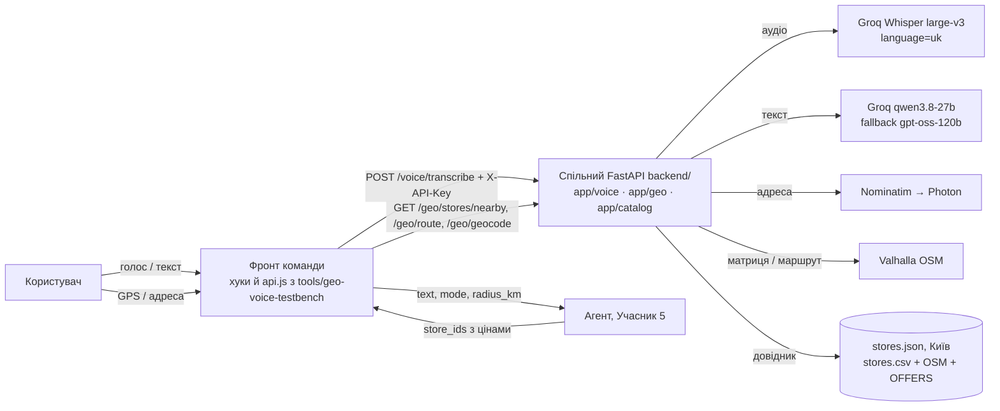

# Модуль «Голос + Геолокація» (Учасник 1)

Голосовий запит → чистий український текст із режимом пересування й радіусом; координати користувача → усі
магазини мереж поруч із часом у дорозі, рекомендований магазин і маршрут на карті.

## Архітектура



**Шлях запиту.** Мікрофон (MediaRecorder, до 60 с) → `/voice/transcribe` → Whisper → LLM-чистка
(`{text, mode, radius_km}`) → захист від галюцинацій → фронт віддає `text` агенту. Паралельно GPS
або адреса → `/geo/stores/nearby` → карта й список → клік на магазин → `/geo/route` → лінія маршруту (GeoJSON)
і посилання Google Maps (пішки / авто / громадський транспорт).

## API

Модулі спільного бекенду (`backend/app/geo/`, `backend/app/voice/`), підключені в `app/main.py` за
`X-API-Key`, як і каталог. Агент може викликати `app.geo.service` / `app.voice.service` напряму, без HTTP.

| Endpoint | Що робить |
|---|---|
| `POST /voice/transcribe` (multipart `audio`) | Whisper + чистка → `{text, raw_text, mode, radius_km, duration_s, cleanup}` |
| `POST /voice/parse-text` `{text, source}` | Та сама чистка для ручного вводу й Web Speech |
| `GET /geo/stores/nearby?lat&lng&mode=walk\|car&radius_km&store_ids=` | Усі магазини в радіусі + до 5 найближчих із цінами поза ним, за часом у дорозі, + `recommended_store_id` |
| `GET /geo/route?lat&lng&store_id&mode` | Лінія маршруту (Valhalla) як GeoJSON `[lng, lat]` + посилання Google Maps |
| `GET /geo/geocode?q&suggest` / `GET /geo/reverse?lat&lng` | Адреса ↔ координати (лише Київ, українською) |
| `GET /geo/stores` | Увесь довідник для оглядової карти |

Помилки повертаються як `{"detail": {"code", "message"[, "fallback"]}}` (`message` англійською, текст для
людини UI бере за `code` — таблиця в HANDOFF). Якщо `fallback: true`, фронт
пропонує розпізнавання в браузері (Web Speech), а ручний ввід доступний завжди.

**Контракт з Учасником 5 (агент):** отримує `text` (очищений) і `raw_text`; `mode`/`radius_km` уже
витягнуті нами. Агент віддає `store_ids` магазинів, де є кошик із підтвердженою ціною й наявністю
(сирі `store_id` з `/catalog` — `"482010105"` / uuid; приймаються й `zakaz:`/`silpo:`). `recommended_store_id` тоді
дорівнює найближчому за часом із них, навіть якщо він поза радіусом.

Повні контракти з прикладами відповідей і що брати у фронт — [tools/geo-voice-testbench/HANDOFF.md](../tools/geo-voice-testbench/HANDOFF.md).

**Обсяг демо — лише Київ** (`SERVICE_CITIES` у `backend/.env`, межі в `CITY_BBOX` у `app/geo/area.py`). Точки
поза Києвом → 422 «Поки працюємо лише по Києву». Щоб повернути інші міста: додати межі в `CITY_BBOX`, місто в
`SERVICE_CITIES` і перезібрати `uv run python -m app.geo.build_stores` (або `--all-cities`).

## Дані магазинів

`python -m app.geo.build_stores` → `app/geo/data/stores.json`: **238 магазинів Києва** (Сільпо 113, NOVUS 70,
ЕКО маркет 25, Auchan 16, METRO 4, Megamarket / Ultramarket / За Раз по 3, Епіцентр 1). Без фільтра міст —
567 магазинів у 84 містах.

- **Список Учасника 2** (`stores.csv`: Zakaz.ua + Сільпо, 519 рядків) — магазини з онлайн-каталогом
  (`online_catalog`). Відкинуто
  7 службових філій «delete_…» і 3 записи з битими координатами (`1.0,1.0` тощо). Філії однієї мережі
  ближче 60 м зведено в один магазин з `alt_ids` (переважно Сільпо).
- **OpenStreetMap** — фізичні NOVUS / Auchan / METRO / ЕКО маркет без онлайн-цін (у Києві +98; по всій країні +152). Точку злито з
  магазином зі списку, якщо вона тієї ж мережі ближче 200 м. Відкинуто закордон, окупований Крим і точки
  далі 25 км від будь-якого магазину зі списку («лише міста, для яких є дані»). Сільпо з OSM не беремо, бо
  API Сільпо повніший. Адреси без `addr:*` дозаповнено зворотним геокодингом.
- **OFFERS Учасника 2** — `has_online_prices: true` лише для магазинів, де є товари з `in_stock=true`
  (ціни й наявність прив'язані до пари «магазин × товар»). Поки джерело — `offers_sample.csv`
  (5 київських магазинів, категорія «молоко»); з доступом до БД `load_offer_store_ids()` у
  `app/geo/offers.py` замінюється запитом до таблиці OFFERS.
- **Каталог Учасниці 2** (основне джерело цін) — `has_online_prices = offers_count >= PRICED_MIN_OFFERS` (50) з
  `/catalog/stores?city=Київ`: `--catalog URL|JSON` (кілька джерел об'єднуються). Зараз 62 магазини з цінами.
- **ID у відповідях — за контрактом команди:** `store_id` + `chain` + `source`; лише для OSM-магазинів без цін
  `store_id` внутрішній (`"osm:n123"`).

## Ключові компроміси

| Рішення | Чому | Ціна рішення |
|---|---|---|
| Groq Whisper large-v3, а не Web Speech | Краща українська, працює в усіх браузерах, однакова якість для evals | Платний API (див. нижче); у браузері лише запасний варіант |
| LLM-чистка + захист від галюцинацій | Регулярні вирази не впораються з «півтора кіло», самовиправленнями | +0.3–0.8 с; якщо LLM щось додає, віддаємо сирий текст |
| Правила (regex) для mode/радіуса поруч з LLM | Явні числа правила беруть детерміновано, працюють навіть без LLM | Перефразування бере LLM |
| Valhalla (OSM) для часу в дорозі | Без ключа, пішки + авто, лінія маршруту | Публічний сервер: fair use, ліміт 100 точок → батчі по 99; при збої оцінка за прямою (`estimated`) |
| Громадський транспорт лише посиланням | Valhalla без розкладу Києва; Google Directions потребує білінгу | Час на транспорті рахує Google, не ми |
| Радіус за прямою, сортування за часом | Дешевий відбір + чесний порядок | Магазин «у радіусі 3 км» може бути 5 км дорогою |
| Статичний `stores.json` | Vercel: файлова система лише для читання, старт без БД | Оновлення — перезапуск скрипта (до підключення БД Учасника 2) |
| Рекомендований магазин може бути поза радіусом | Маршрут веде туди, де ціну підтверджено, а не до найближчого без цін | Довший шлях; позначено `in_radius: false` |

Припущення fallback-оцінки (коли Valhalla недоступний): пішки 4.8 км/год × 1.3 обходу, авто 25 км/год × 1.4.

## Вартість одного голосового запиту

Ціни Groq (21.11.2026, [models](https://console.groq.com/docs/models)): Whisper large-v3 — $0.111/год аудіо,
мінімум 10 с на запит; `qwen/qwen3.8-27b` — $0.80 / $4.00 за 1M вхідних / вихідних токенів.

| Складова | Розрахунок | $ / запит |
|---|---|---|
| Whisper, запит 10–20 с | 20 с × $0.111 / 3600 | ≈ $0.0006 |
| Чистка, ~460 токенів (≈400 вхід + 60 вихід, з evals) | 400 × 0.8e-6 + 60 × 4e-6 | ≈ $0.0006 |
| Геокодинг, маршрути, карта | Nominatim, Photon, Valhalla, тайли OSM | $0 (fair use) |
| **Разом** | | **≈ $0.0012** |

На безкоштовному тарифі Groq демо коштує $0. Ліміти: Whisper 20 запитів/хв і 2000 на день; `qwen3.8-27b`
30 запитів/хв, 1000 на день і 8K токенів/хв, тому за серії запитів вмикається запасна `gpt-oss-120b`
(див. evals). Для продакшну потрібні платний тариф Groq і власні Valhalla/Nominatim або комерційні
аналоги, бо публічні сервери OSM не розраховані на комерційне навантаження.

## Evals

25 кейсів (`app/voice/evals/cases.json`): списки, страви, бюджет, обмеження складу, слова-паразити,
самовиправлення, числа словами, режим і радіус. Кейс пройдено, лише якщо **водночас** збережено всі
продукти й числа, прибрано паразити і правильно визначено mode та radius_km.
Скрипт: `uv run python -m app.voice.evals`, звіти: `app/voice/evals/results/`.

| Набір | Пройдено | Mode | Радіус | Продукти збережено | WER | Затримка p50 |
|---|---|---|---|---|---|---|
| Текст → LLM-чистка (суворий захист після QA) | **24/25** | 100% | 100% | 100% | — | 0.33 с |
| Синтетичне аудіо (голос macOS «Lesya») → Whisper → чистка | **21/25** | 100% | 100% | 88% | 12% | 0.67 с |
| Справжні записи людей | очікуємо записів | | | | | |

Захист від галюцинацій: 0 хибних відхилень на 100 прогонах справжньої LLM (останній — із суворішим
захистом після QA, який ловить додані продукти, вигадані числа й загублені «без/не/тільки») (в одному з прогонів обидві LLM
упирались у ліміт і повертали сирий текст без збою; запасна модель спрацювала 1–16 разів залежно від
частоти запитів).

**Приклади помилок:**
1. *Самовиправлення:* «яблука, банани, **ой ні**, апельсини» → «яблука, **банани**, апельсини» — модель не
   прибрала скасований продукт. Агент отримає зайвий товар. Можливе виправлення — few-shot приклад у
   промпті (ми навмисно не підганяли промпт під тестовий набір).
2. *Розпізнавання:* «дитяче **пюре**» → «дитячі **тури**», «**курка**» → «**корка**» — помилки Whisper на
   синтетичному голосі. Частково їх лікує словник брендів і продуктів у підказці Whisper (чекаємо
   PRODUCTS з БД Учасника 2).

Також суворий критерій зарахував як помилку «для двох» → не «для 2» (зміст збережено).

## Як ми використовували ШІ-інструменти

- **У продукті:** Whisper (розпізнавання), LLM (чистка + витяг обмежень) з детермінованим захистом
  і правилами як запасним шляхом.
- **У розробці:** Claude Code — дослідження API (Zakaz.ua, Сільпо, Valhalla, Nominatim: ліміти перевірено
  живими запитами), вибір моделі чистки за тестом трьох LLM на українських фразах, генерація коду й тестів
  (pytest: 110 тестів модулів у спільному наборі зі 170), браузерна перевірка сценарію. Рішення про продукт (радіуси, мережі, «недалеко» =
  1 км, довжина запису) ухвалювала людина.

## Запуск локально (з `backend/`, як увесь бекенд команди)

```bash
uv sync
cp .env.example .env      # вписати API_KEYS і GROQ_API_KEY (DATABASE_URL потрібен лише каталогу)
uv run uvicorn app.main:app --reload             # http://localhost:8000/docs
uv run pytest && uv run ruff check .
uv run python -m app.geo.build_stores            # перебудувати довідник (--catalog 'http://…/catalog/stores?city=Київ')
uv run python -m app.voice.evals --text --delay 7
```

Тестовий стенд для мікрофона й GPS: `tools/geo-voice-testbench` (див. HANDOFF), http://localhost:5174.

**Vercel:** у `main` конфігурації немає; наш старий `vercel.json` прибрано разом з окремим застосунком.
Залишилось вирішити команді, як деплоїти спільний бекенд (Python + БД + планувальник ETL у процесі) і фронт.
Увага: якщо деплоїти на Vercel без збірки, пресет «Other» роздає корінь репозиторію як статику — потрібен
`outputDirectory` (наприклад, `frontend/dist`).

## Що чекаємо від команди

- **Учасник 2:** доступ до БД — STORES замість `stores.csv`, OFFERS замість `offers_sample.csv`
  (`load_offer_store_ids()`); топ брендів з PRODUCTS для словника Whisper
  (`app/voice/data/stt_vocabulary.txt`); функція «магазини, де є кошик» → `store_ids`. У `stores.csv` три
  записи Сільпо мають биті координати (`1.0, 1.0` тощо) — варто виправити в джерелі.
- **Фронтенд команди:** забрати хуки й `api.js` за [HANDOFF.md](../tools/geo-voice-testbench/HANDOFF.md).
- **Учасник 5:** підтвердити контракт `text`/`raw_text` → `store_ids`.
