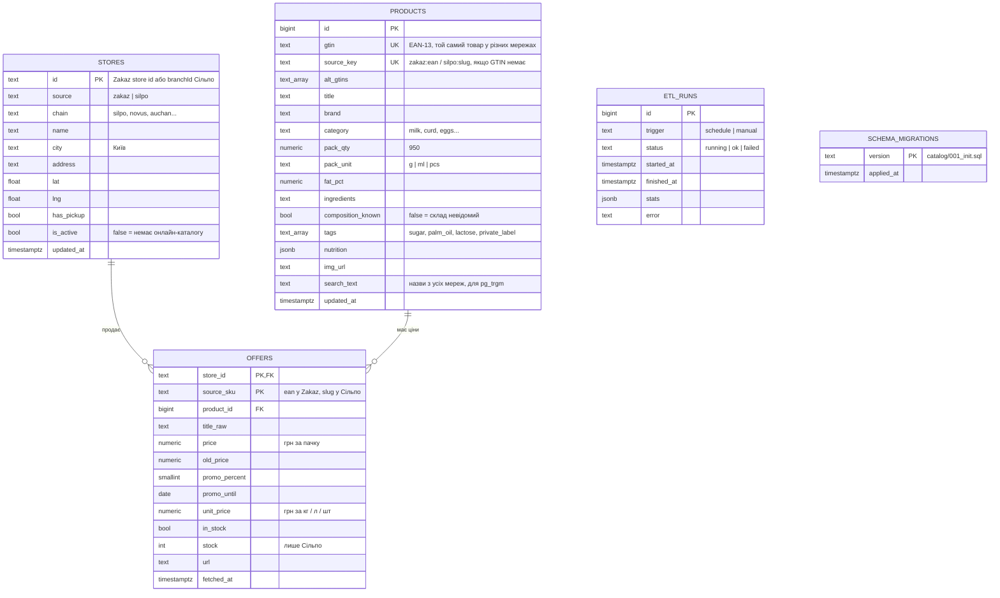

# Схема БД (модуль catalog)

Джерело правди — SQL-міграції в [`backend/app/catalog/migrations/`](../backend/app/catalog/migrations/). Діаграму оновлюй разом із новою міграцією.

- `offers` — це ціна конкретного товару в конкретному магазині. Одна пачка молока в 5 мережах дає 1 рядок у `products` і 5 у `offers`.
- `etl_runs` — журнал нічного ETL (03:00 за Києвом). З нього UI бере «ціни оновлено о …».
- `schema_migrations` — службова таблиця раннера міграцій. На всіх таблицях увімкнено RLS: публічний REST Supabase до них не має доступу.
- Сирі відповіді API в БД не зберігаємо: одна сторінка пошуку займає 150–360 КБ, і нічний прогін швидко з'їв би 500 МБ безкоштовного Supabase. Таблицю `raw_items` прибрано міграцією `004_drop_raw_items.sql`; для налагодження парсера сирі відповіді кладемо файлами в `backend/data/raw/` (є в `.gitignore`).
